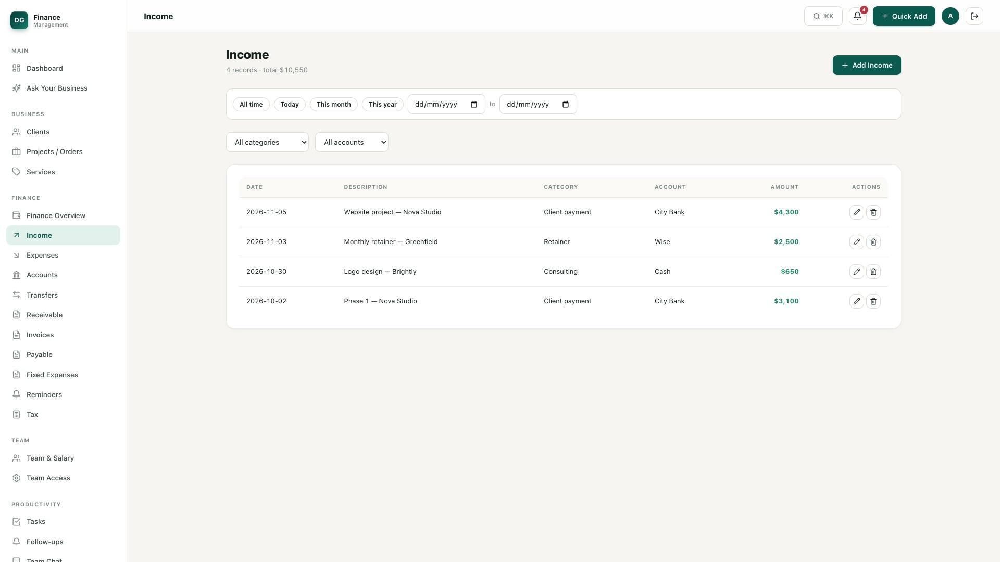
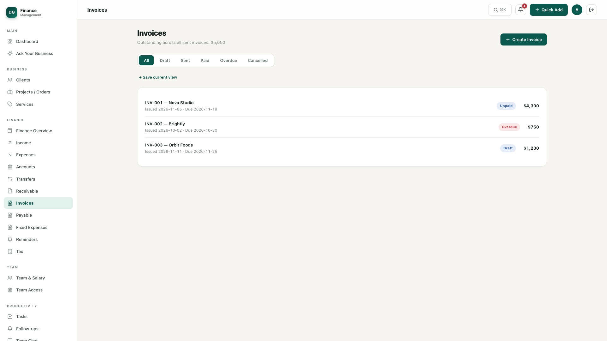
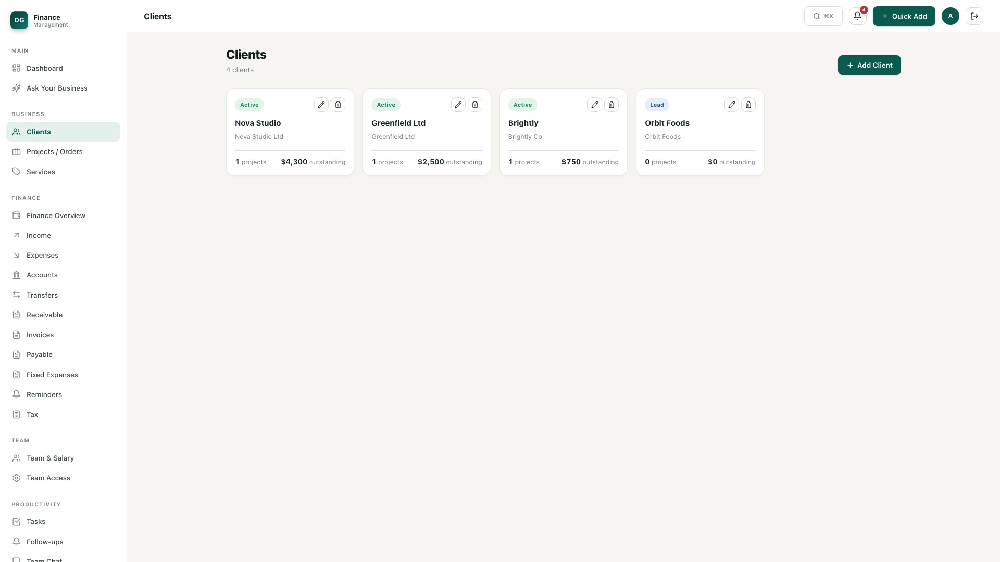
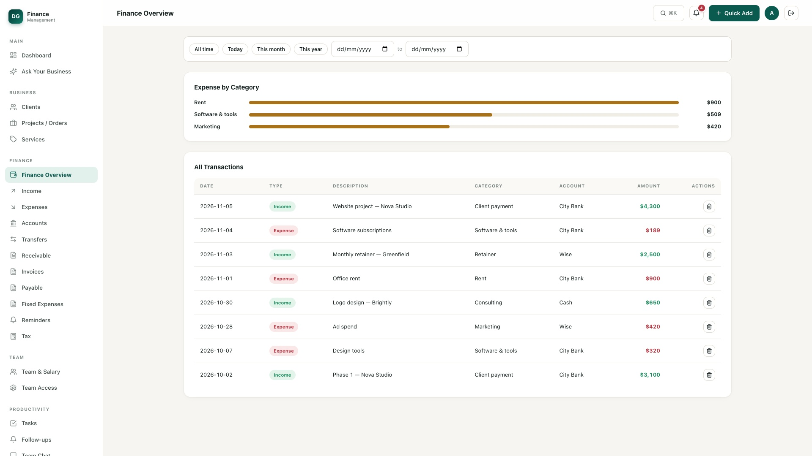
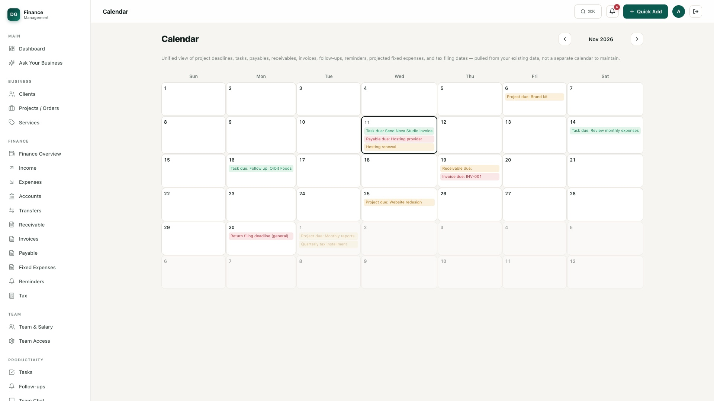

# Dgtal Finance Manager

**One calm workspace for invoices, income and expenses, clients, projects, team and tax.**
Built for freelancers, agencies and small businesses.

[**Try the live demo**](https://finance.dgtalgrow.com/) &nbsp;·&nbsp; [Website](https://management.dgtalgrow.com/) &nbsp;·&nbsp; [Android app](../../releases/latest) &nbsp;·&nbsp; [Product Hunt](https://www.producthunt.com/products/dgtal-finance-manager) &nbsp;·&nbsp; [G2](https://www.g2.com/products/dgtal-finance-manager/reviews)

---

## Try it in 10 seconds (no sign-up)

Open **[finance.dgtalgrow.com](https://finance.dgtalgrow.com/)** and press one of the **"Try the live demo"** buttons on the login screen. No password is needed.

| Button | What you see |
|---|---|
| **Owner / Admin panel** | Everything: billing, team access, settings, all modules |
| **Admin** | Runs the workspace, cannot delete finance records |
| **Manager** | Clients, projects and tasks, no finance |
| **Finance** | Invoices, income, expenses, payables and receivables |
| **Team Member** | Sees clients and projects, works on tasks |
| **Viewer** | Read-only |
| **Client portal** | What your client sees: shared projects, updates and invoices |

> The demo is a **shared workspace** with sample data. Everyone sees the same data, so please do not type any real or personal information into it. Account and billing changes are switched off in demo sessions.
> The host shows a short security check ("One moment, please...") for a few seconds on the first visit.

## Screenshots

| | |
|---|---|
|  |  |
| **Dashboard**: balances, cash flow, "where is my money?" | **Income and expenses** across accounts |
|  |  |
| **Invoices** with status and PDF export | **Clients** and receivables |
|  |  |
| **Finance overview** | **Projects and orders** |

**Calendar** of due dates

All screenshots use sample data.

## What it does

- **Dashboard**: total balance, income vs expense, net cash flow, spending by account.
- **Money**: accounts, income, expenses, transfers, categories, multi-currency, fixed expenses and recurring items.
- **Fixed bills and salaries with due dates**: a live countdown, a "Mark paid" button that unlocks five days before the due date, and a reminder popup each morning and evening.
- **Invoices**: create, send, mark paid or overdue, record payments, branded **PDF** export, recurring invoices.
- **Clients, projects and services**: receivables, payables, follow-ups and project status.
- **Tax estimator**: country-aware (Bangladesh built in, other countries through rule sets), payments and settings.
- **Team**: members, salary tracking, roles and permissions, invitations, tasks, team chat.
- **Client portal**: clients sign in with a one-time email code and see only the projects and invoices shared with them.
- **Ask Your Business**: an AI assistant that answers questions about your own data (an offline mock provider is built in).
- **Recycle bin** for every delete, saved views, command palette, reports, notifications and a calendar.
- **Plans and trial**: Starter, Professional and Business plan limits with a 14-day trial.

## Roles and permissions

Seven built-in views of the same workspace: Owner, Admin, Manager, Finance, Project Manager, Team Member and Viewer. Permissions are checked on the server for every action, and the owner can adjust them per team member.

## Built with

Node.js and Express, PostgreSQL (plain SQL migrations, no ORM), React 18 with Vite 6, Socket.IO for team chat, pdfkit for invoices. Multi-tenant by design: every record belongs to a workspace and every query is scoped to it.

- Passwords hashed with bcrypt, email one-time codes, session cookies, rate limiting, Helmet security headers, parameterised SQL.
- A recycle-bin restore engine that only writes allow-listed tables and never overwrites existing rows.
- 27 automated unit tests, CI with a database migration check, and an `npm audit` with no known vulnerabilities at the time of release.
- Deploys with Docker, on a VPS or on cPanel.

## Android app

A lightweight Android app that opens the web app full screen, with file upload and PDF download support.

1. Download **`DgtalFinanceManager-1.1.0.apk`** from the [latest release](../../releases/latest).
2. Open it on your phone and allow installation from this source when Android asks.
3. Sign in or tap a demo button.

The APK is signed by DGTAL GROW. It needs an internet connection because the app is the live web app.

## Source code

This repository is a **showcase**: screenshots, feature overview, demo and the Android app. **The source code is not published here.** The full source (Node.js, React, PostgreSQL, Docker files, setup guide and tests) is offered as a licence through the Vibe96 marketplace, and I can also help you run it for your business. To get in touch, reach out through [management.dgtalgrow.com](https://management.dgtalgrow.com/).

## Links

| | |
|---|---|
| Live demo | https://finance.dgtalgrow.com/ |
| Website and pricing | https://management.dgtalgrow.com/ |
| Product Hunt | https://www.producthunt.com/products/dgtal-finance-manager |
| G2 | https://www.g2.com/products/dgtal-finance-manager/reviews |
| SaaSHub | https://www.saashub.com/dgtal-finance-manager-alternatives |

---

&copy; DGTAL GROW. All rights reserved. The name, logo, screenshots and text in this repository may not be reused without permission. The Android app is provided as is.
