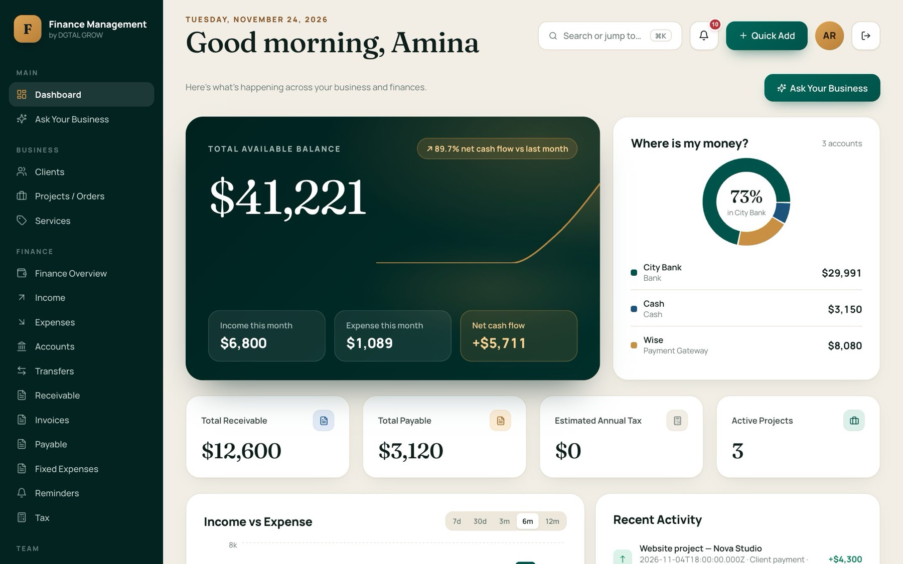
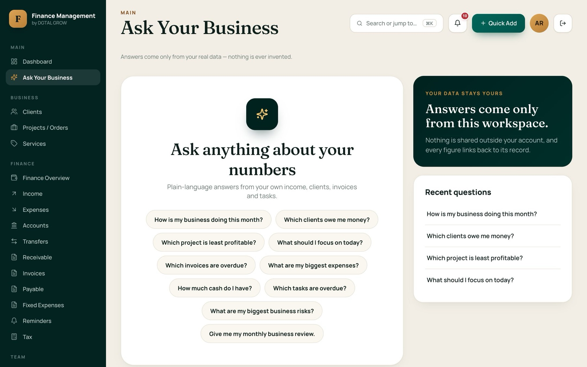
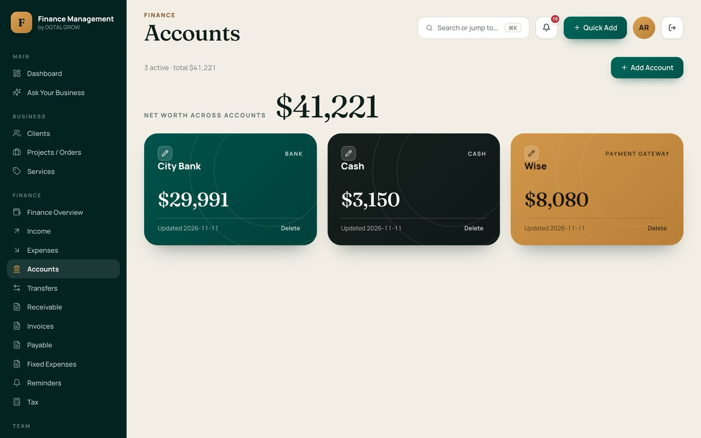
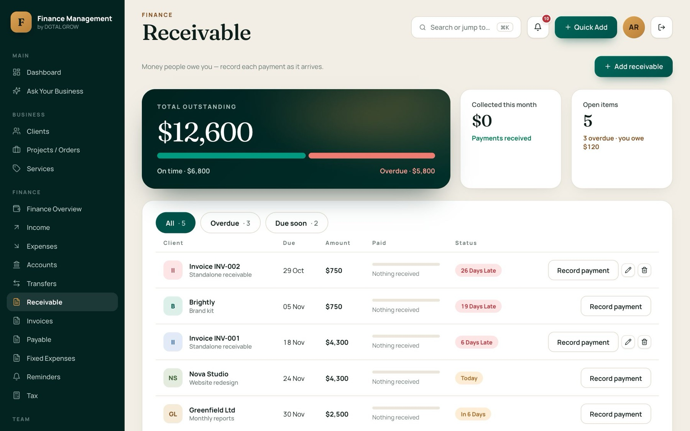
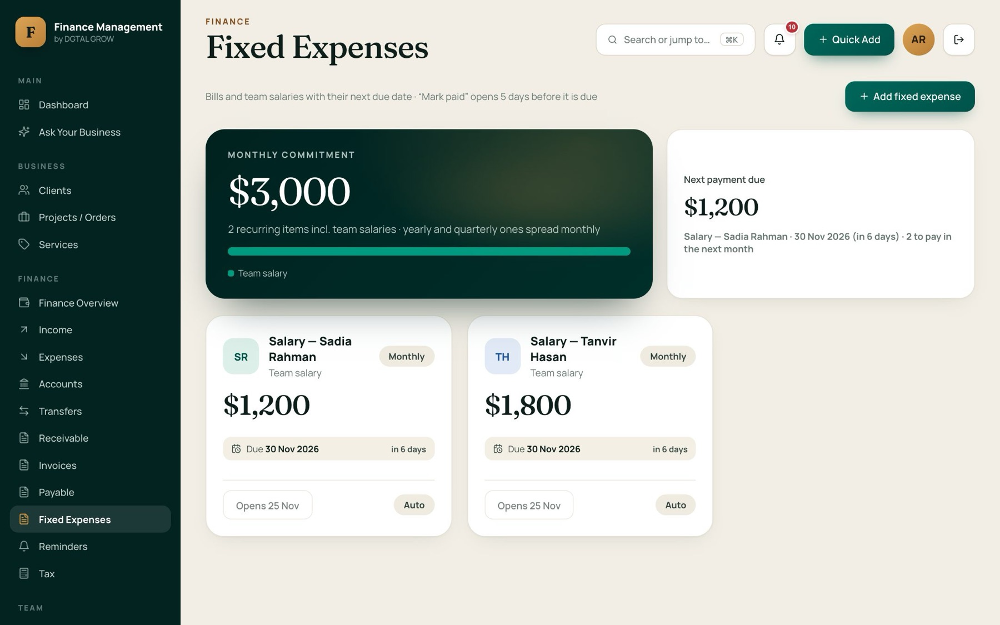
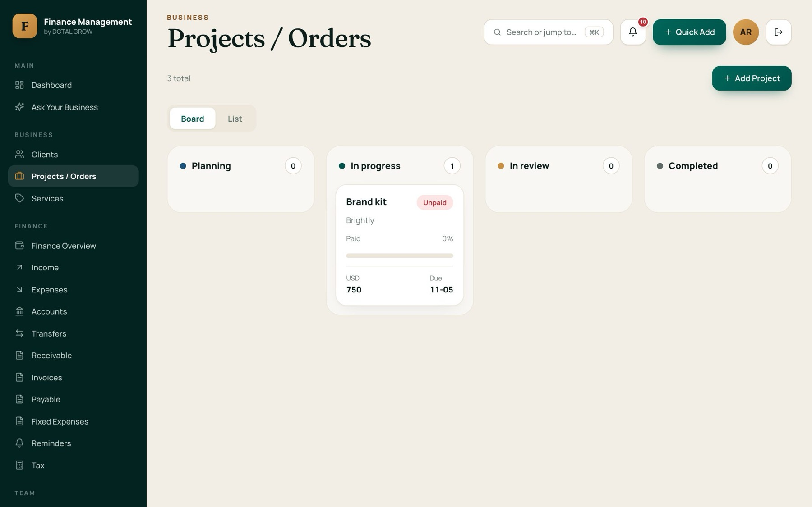
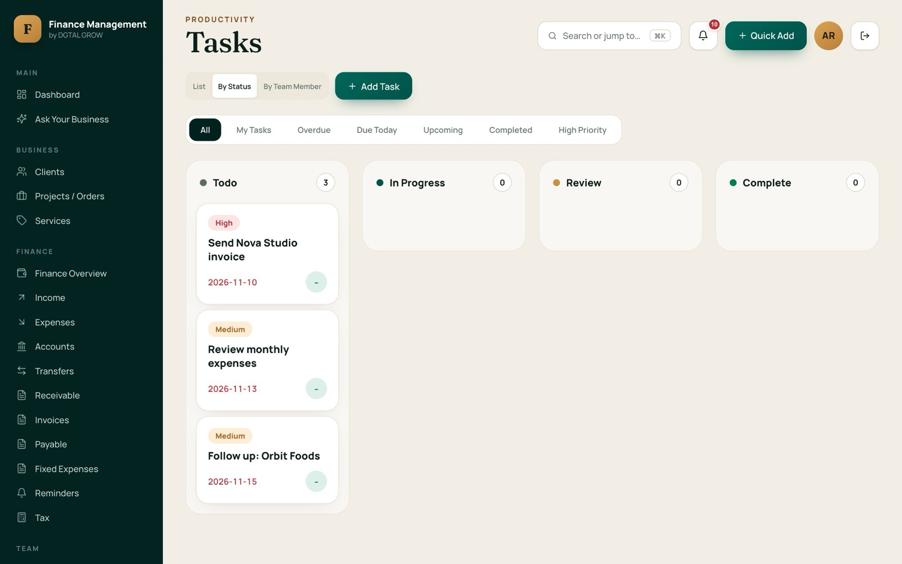
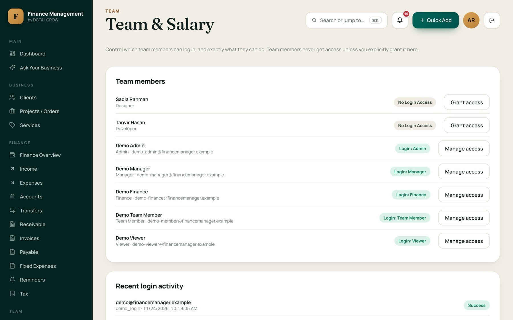

# Dgtal Finance Manager

**See your whole business in one place: money, invoices, clients, projects, tasks, team and deadlines.**
A web app for freelancers, agencies and small businesses.

[**Try the live demo**](https://finance.dgtalgrow.com/) &nbsp;·&nbsp; [Website](https://management.dgtalgrow.com/) &nbsp;·&nbsp; [Product Hunt](https://www.producthunt.com/products/dgtal-finance-manager) &nbsp;·&nbsp; [G2](https://www.g2.com/products/dgtal-finance-manager/reviews)

---

## Try it in 10 seconds (no sign-up)

Open **[finance.dgtalgrow.com](https://finance.dgtalgrow.com/)** and press one of the **"Try the live demo"** buttons on the login screen. No password is needed.

| Button | What you see |
|---|---|
| **Owner / Admin panel** | Everything: billing, team access, settings, all modules |
| **Admin** | Runs the workspace, cannot delete finance records |
| **Manager** | Clients, projects and tasks, no finance |
| **Finance** | Invoices, income, expenses, payables and receivables |
| **Team Member** | Sees clients and projects, works on tasks |
| **Viewer** | Read-only |
| **Client portal** | What your client sees: the projects and invoices you share with them |

> The demo is a **shared workspace** with sample data. Everyone sees the same data, so please do not type any real or personal information into it. Account and billing changes are switched off in demo sessions. The host shows a short security check ("One moment, please...") for a few seconds on the first visit.

---

## What you get, section by section

### 1. Dashboard: know where you stand in ten seconds

Your total balance across every account, this month's income and expenses, net cash flow, what clients still owe you, what you owe, your estimated tax and active projects. An income-vs-expense chart and a recent-activity list show how the month is going.

**Why it helps:** no more opening the bank app, a spreadsheet and your invoices just to answer "how are we doing?".

### 2. Ask Your Business: questions in plain language

Ask "Which clients owe me money?", "What are my biggest expenses?" or "Which invoices are overdue?" and get an answer from your own records. Answers come only from your workspace, and your data is not shared outside your account.

**Why it helps:** you get answers without building reports or learning filters.

### 3. Accounts: every account in one view

Bank, cash and payment-gateway accounts with their balances and one net-worth total.

**Why it helps:** you see how much money you really have, and where it sits.

### 4. Invoices: create, send and download as PDF

Invoice statuses (draft, sent, overdue, paid) with totals at the top. Select an invoice to preview it, then **Download PDF** or **Send**.

**Why it helps:** professional invoices in minutes, and you always know which ones are still unpaid.

### 5. Receivable: chase what you are owed

Total outstanding split into on time and overdue, with days late per item and a **Record payment** button for part or full payments.

**Why it helps:** late payments stop hiding in your inbox.

### 6. Fixed expenses and salaries: never miss a due date

Recurring bills and team salaries show the next due date and a countdown. The **Mark paid** button opens five days before the due date, and a reminder popup appears each morning and evening for items that are due soon.

**Why it helps:** rent, hosting and salaries get paid on time, without a separate reminder app.

### 7. Clients: who pays, who owes, who is a lead

Each client card shows lifetime revenue, the outstanding amount, how many projects are active and the status (Active, Lead, Inactive).

**Why it helps:** you can see your best clients and your slow payers at a glance.

### 8. Projects and orders: a board for every job

A board (Planning, In progress, In review, Completed) or a list, with the client, paid percentage and due date on every card.

**Why it helps:** you see which jobs are moving and which are paid.

### 9. Tasks: keep the team on the same page

A task board by status or by team member, with priorities and filters such as My Tasks, Overdue, Due Today and High Priority.

**Why it helps:** nothing falls through the cracks, and everyone knows what is next.

### 10. Calendar: every deadline in one place

Project deadlines, tasks, payables, receivables, invoices, follow-ups, reminders, upcoming fixed expenses and tax dates appear on one calendar, pulled from your existing data. There is no separate calendar to maintain.

**Why it helps:** one look shows what needs you today and what is coming up.

### 11. Team access: give people exactly the access they need

Choose which team members can log in and exactly what each role can see and do (Admin, Manager, Finance, Team Member, Viewer). A recent login activity list shows who signed in.

**Why it helps:** your team works in the same system without seeing money they should not see.

---

## Also included

- **Client portal:** clients sign in with a one-time email code and see only the projects and invoices you share with them.
- **Income, expenses, transfers and categories**, with multi-currency support.
- **Tax estimator** with country rules (Bangladesh built in) and tax payment records.
- **Team salaries** that flow into fixed expenses.
- **Recycle bin** for every delete, saved views, a command palette, reports and notifications.
- **Plans and trial:** Starter, Professional and Business limits with a 14-day trial.

## Built with

Node.js and Express, PostgreSQL (plain SQL migrations, no ORM), React 18 with Vite 6, Socket.IO for team chat and pdfkit for invoices. It is multi-tenant: every record belongs to a workspace and every query is scoped to it.

- Passwords hashed with bcrypt, email one-time codes, session cookies, rate limiting, Helmet security headers and parameterised SQL.
- A recycle-bin restore engine that only writes allow-listed tables and never overwrites existing rows.
- 27 automated unit tests and a CI database migration check.
- Deploys with Docker, on a VPS or on cPanel.

## Source code

This repository is a **showcase**: screenshots, a feature overview and a live demo. **The source code is not published here.** The full source (Node.js, React, PostgreSQL, Docker files, setup guide and tests) is offered as a licence through the Vibe96 marketplace, and I can also help you run it for your business. To get in touch, reach out through [management.dgtalgrow.com](https://management.dgtalgrow.com/).

## Links

| | |
|---|---|
| Live demo | https://finance.dgtalgrow.com/ |
| Website and pricing | https://management.dgtalgrow.com/ |
| Product Hunt | https://www.producthunt.com/products/dgtal-finance-manager |
| G2 | https://www.g2.com/products/dgtal-finance-manager/reviews |
| SaaSHub | https://www.saashub.com/dgtal-finance-manager-alternatives |

---

&copy; DGTAL GROW. All rights reserved. The name, logo, screenshots and text in this repository may not be reused without permission. Screenshots show sample data from the shared demo workspace.
